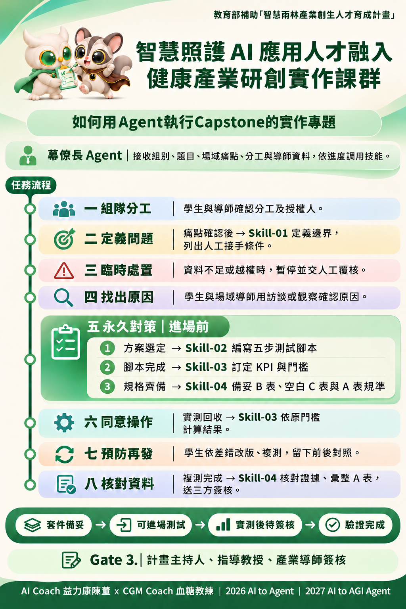

# 智慧照護 AI 應用人才融入健康產業研創實作課群

教育部補助「智慧雨林產業創生人才育成計畫」｜Capstone 第 16 週場域驗證與迭代｜v1.2.0

## 使用方式

將專題組別、題目、場域痛點、團隊分工及導師資料交給 Agent，依任務階段調用下列技能。每一步將產出交給下一步，缺少資料時記錄缺項及補件人。

1. [定義邊界](skills/skill_01.md) — 確認分工與覆核點。
2. [設計腳本](skills/skill_02.md) — 編寫五步測試流程。
3. [校準指標](skills/skill_03_kpi.md) — 訂出比較基準。
4. [彙整審查](skills/skill_04_gate_3.md) — 備齊三份審查表。

## 完成條件

- **套件備妥**　B 表完成、C 表可填、A 表評分規準備妥。
- **可進場測試**　負責人確認場域、資料使用及 L2 人工覆核，留下同意紀錄。
- **實測後待簽核**　收齊實填 C 表、五項證據與學生作品，至少完成一次改版複測。
- **驗證完成（通過）**　五項證據齊備且無否決事項；總分 ≥75、各項 ≥18，A 表三方簽核。

A 為審查評分表，B 為進場驗證規準書，C 為實測與迭代回覆表。五項證據包括 20 組金標準對比、系統差錯日誌、原型操作錄影或截圖、去識別化切結書與改版紀錄。詳細核對規則見 Skill-04。

## 如何用 Agent 執行 Capstone 的實作專題

| 步驟 | 何時使用技能 | 交付或判斷 |
|---|---|---|
| 一 組隊分工 | 學生與導師先確認角色 | 分工與授權人 |
| 二 定義問題 | 痛點確認後使用 Skill-01 | 範圍、分工與人工接手條件 |
| 三 臨時處置 | 資料不足或越權時暫停 | 記錄缺項並交人工覆核 |
| 四 找出原因 | 學生與場域導師訪談或觀察 | 經確認的原因 |
| 五 永久對策 | 方案選定用 Skill-02，腳本完成用 Skill-03，規格齊備用 Skill-04 | 五步腳本、指標門檻、進場套件 |
| 六 同意操作 | 實測回收後再用 Skill-03 | 依原門檻計算結果 |
| 七 預防再發 | 學生依落差改版、複測 | 版本及前後對照 |
| 八 核對資料 | 複測完成後再用 Skill-04 | 核對證據、彙整 A 表並送三方簽核 |

## 快速開始

下載專案，將本頁與四份技能交給可讀取 Markdown 的 Agent，再提供小組資料。可直接輸入：「請依任務流程判斷我組目前的步驟，列出應使用的 Skill、已知資料、缺項與下一位負責人。」請用[教學案例](examples/handoff.md)先練習判斷狀態。

## 延伸閱讀與發布資料

- [網誌與圖卡設計風格](docs/article.md)
- [版本紀錄與 Release Notes](CHANGELOG.md)
- [貢獻方式](CONTRIBUTING.md)與[授權](LICENSE)

適用於學生團隊、指導教授與產業導師的場域驗證教學。此版本提供 Agent 工作規格，實際操作、覆核與簽核由具權限的人員完成。

AI Coach 益力康陳董 x CGM Coach 血糖教練 | 2026 AI to Agent | 2027 AI to AGI Agent
