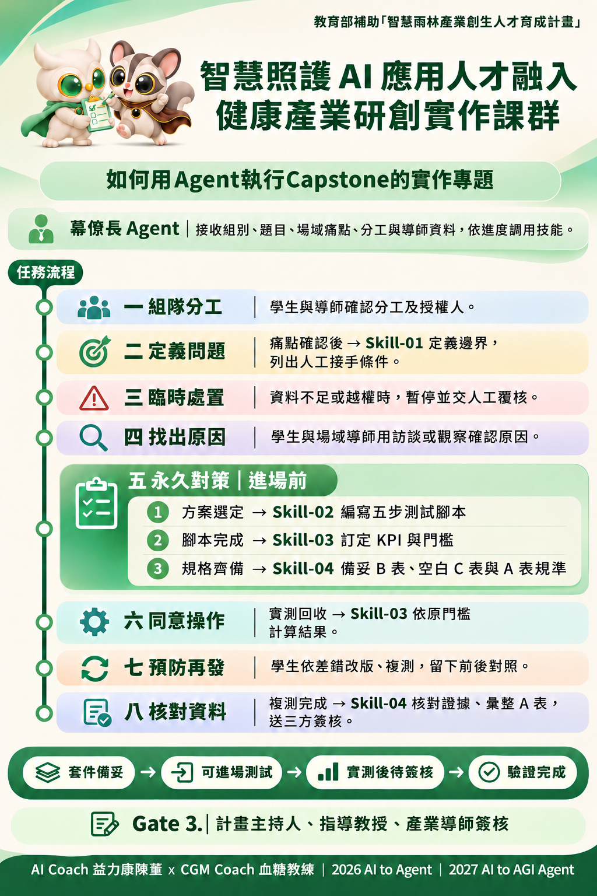

# 如何用 Agent 執行 Capstone 的實作專題

**設計風格｜智慧雨林・翡翠雙萌流程圖卡風**  
*Emerald Rainforest · Dual-Mascot Workflow Cards*

以翡翠綠搭配奶油白，呼應「智慧雨林」計畫。綠披風貓頭鷹與棕金披風蜜袋鼯一起勾選清單，帶出團隊協作的主題。淡色區塊區分八個步驟，左側綠線引導閱讀，第五步以較大的版面呈現三項技能的使用時機。

分組完成、題目也選好了，學生最常卡在下一句：「我們要怎麼證明，這個做法真的有用？」在「智慧照護 AI 應用人才融入健康產業研創實作課群」中，這張任務圖卡把場域問題、測試方法與驗收證據串成八個步驟。學生和導師負責判斷，幕僚長 Agent 依進度調用 Skill，讓每一組都知道下一步要做什麼、該留下什麼資料。

## 一到四｜組好團隊，把問題說清楚

先由學生與導師確認分工，以及誰有權同意操作。等場域痛點確認後，Agent 才調用 Skill-01，寫清楚這次要處理的範圍，以及哪些情況需要人工接手。遇到資料不足或超出授權，就暫停並交由人工覆核。接著，學生與場域導師透過訪談或現場觀察，確認問題發生的原因。

## 五到六｜先訂判準，再進場測試

第五步「永久對策」是進場前的準備。方案選定後，Skill-02 把做法寫成五步測試腳本；腳本完成後，Skill-03 訂出衡量成效的指標與門檻；規格齊備後，Skill-04 備妥 B 表、空白 C 表與 A 表評分規準。到了第六步，實測資料回收後，再由 Skill-03 依原先門檻計算結果，讓準備與驗收採用同一把尺。

## 七到八｜用複測證據完成驗收

學生依實測落差修改方案、再次測試，留下修改前後的對照。複測完成後，Skill-04 核對證據、彙整 A 表，再送計畫主持人、指導教授與產業導師簽核。走到這一步，學生就能拿著紀錄說明：原本發現什麼問題、改了哪裡，以及哪一筆結果支持最後的結論。

AI Coach 益力康陳董 x CGM Coach 血糖教練 | 2026 AI to Agent | 2027 AI to AGI Agent
